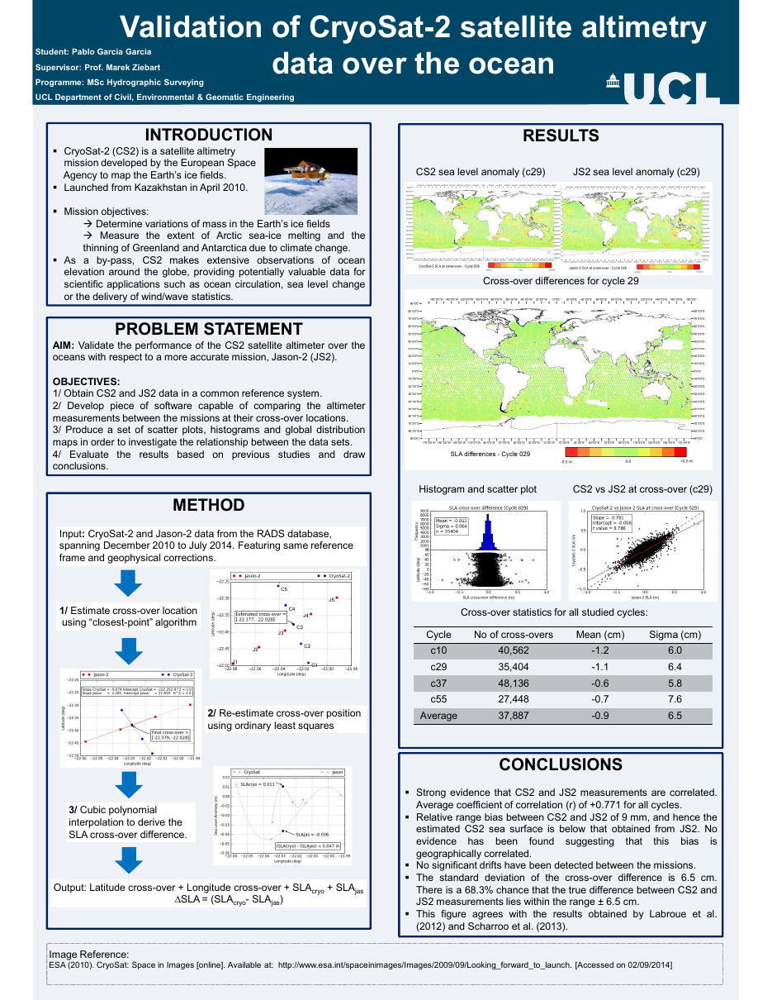
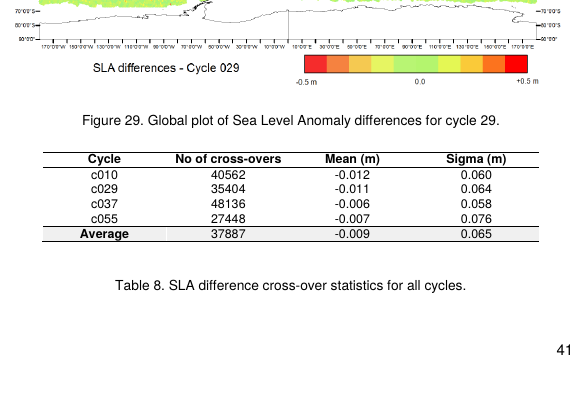
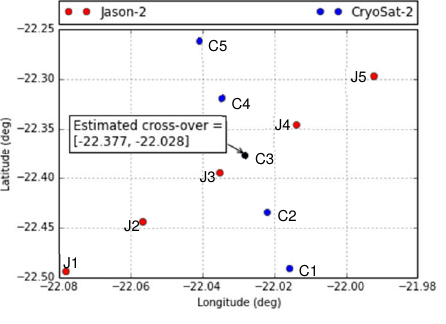
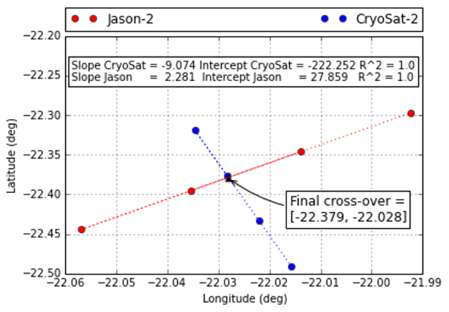
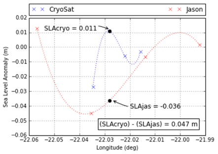

# Validation of CryoSat-2 satellite altimeter data over the ocean

**MSc Hydrographic Surveying, University College London (UCL)** · Dept. of Civil, Environmental & Geomatic Engineering
**Author:** Pablo García García · **Supervisor:** Prof. Marek Ziebart · **Submitted:** 8 September 2014



CryoSat-2 was built to map the Earth's ice fields, but it also measures sea level over the open ocean. This project asks how good those ocean measurements are by comparing them with **Jason-2**, a dedicated ocean altimeter, at the places where the two satellites' ground tracks **cross over**.

📄 [Full dissertation (PDF)](docs/Garcia_MScProject_dissertation.pdf) · 🖼️ [Poster (PDF)](docs/Garcia_MScProject_poster.pdf)

## Key results

Four ~30-day CryoSat-2 sub-cycles (10, 29, 37, 55) spanning December 2010 – July 2014, paired with Jason-2 passes less than 10 days apart. Data come from the [Radar Altimeter Database System (RADS)](http://rads.tudelft.nl) with a common reference frame (DTU10 mean sea surface) and common geophysical corrections.

| Cycle | Period | Cross-overs | Mean ΔSLA (cm) | Std. dev. (cm) | r |
|------:|--------|------------:|---------------:|---------------:|------:|
| 10 | Dec 2010 – Jan 2011 | 40,562 | −1.2 | 6.0 | 0.805 |
| 29 | Jun – Jul 2012 | 35,404 | −1.1 | 6.4 | 0.786 |
| 37 | Jan – Feb 2013 | 48,136 | −0.6 | 5.8 | 0.775 |
| 55 | Jun – Jul 2014 | 27,448 | −0.7 | 7.6 | 0.719 |
| **Mean** | | **37,887** | **−0.9** | **6.5** | **0.771** |

ΔSLA = SLA(CryoSat-2) − SLA(Jason-2).

- **Agreement:** cross-over standard deviation of **6.5 cm**, consistent with Labroue et al. (2012) and Scharroo et al. (2013), who report 5.7 and 5.6 cm on "stable" ocean subsets.
- **Bias:** a small relative bias of about 1 cm (CryoSat-2 sea surface slightly below Jason-2).
- **Stability:** no significant drift between the missions over the study period.
- **Noise vs. waves:** the spread grows with significant wave height, e.g. in the Southern Ocean.

<p align="center">
  <br>
  <em>Cross-over SLA differences, cycle 29 (thesis Fig. 29)</em>
</p>

## Method

1. **Closest-point search.** A cKD-tree finds the nearest pair of measurements between a CryoSat-2 and a Jason-2 pass. Pairs further apart than 0.06° are discarded.
2. **Refine the cross-over position.** Two straight lines are fitted by least squares through the 4 nearest points on each track; their intersection is the cross-over.
3. **Interpolate SLA.** A cubic polynomial through the 4 SLA values on each track is evaluated at the cross-over, and the two values are differenced.

<p align="center">
  
  
  
</p>

## Repository layout

```
.
├── src/xover_finder.py        # cross-over finder (Python 3 port of the original script)
├── scripts/plot_xover.py      # histogram + latitude scatter of ΔSLA
├── scripts/plot_global_map.py # global maps of ΔSLA / SLA (thesis Figs. 25, 27, 29)
├── scripts/make_synthetic_data.py  # fake cross-over CSV for trying the plots/notebook
├── notebooks/crossover_analysis_example.ipynb  # worked example: stats, maps, regression
├── tests/test_crossover.py    # synthetic-track unit tests
├── docs/                      # dissertation, poster, figures
├── requirements.txt
└── LICENSE
```

## Reference

Garcia Garcia, P. (2014). *Validation of CryoSat-2 satellite altimeter data over the ocean.* MSc dissertation, University College London.

## Acknowledgements

Supervisor Prof. Marek Ziebart; CGG for sponsoring the MSc; the Delft Institute of Earth-Oriented Space Research (DEOS) for the RADS data.

## Contact

Pablo García García · https://www.linkedin.com/in/garpablo/<!-- add current email / LinkedIn --> 
